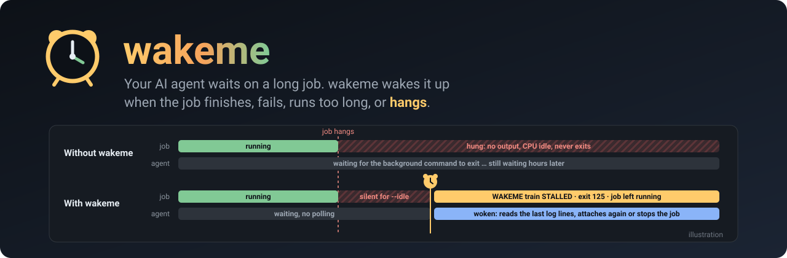
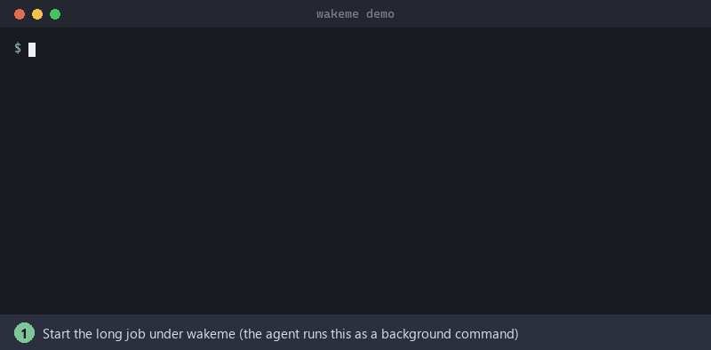
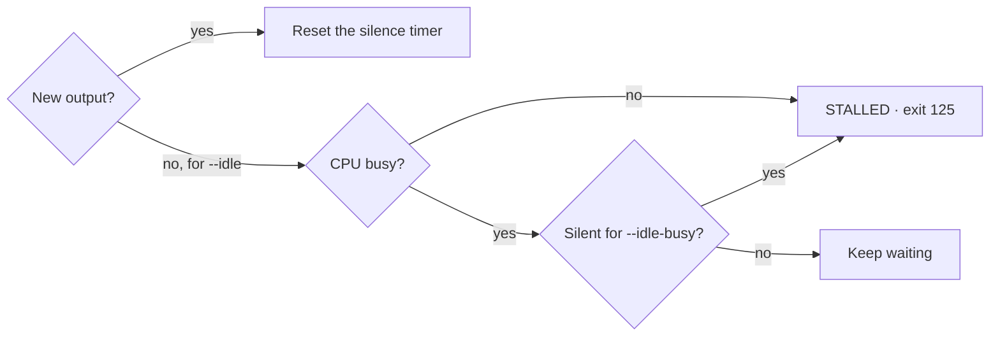
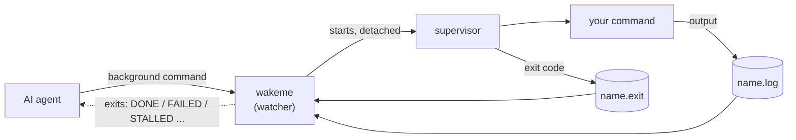

<p align="center">
  
</p>

<p align="center">
  <a href="LICENSE"></a>
  
  
  
  
  <a href="https://github.com/shaojunying/wakeme/stargazers"></a>
</p>

<p align="center">
  <b>English</b> · <a href="README.zh-CN.md">中文</a>
</p>

---

**wakeme runs a long command for your AI agent and exits the moment the command needs attention, so the agent that is waiting on it wakes up.** An agent such as Claude Code that starts a job as a background command is only woken when that command exits. A job that hangs never exits, and the agent waits for hours. `wakeme` turns every outcome, a hang included, into an exit with a clear last line and exit code.

```sh
wakeme --idle 10m -- npm run build
wakeme --idle 15m --expect out/model.bin -- "python train.py"
wakeme --idle 10m -- ssh box1 "cd proj && ./run.sh"
```

## ✨ Why

| | Woken when it ends | Woken when it hangs | Tells hung from slow | Job kept on a false alarm | Nothing to write each time |
|---|:---:|:---:|:---:|:---:|:---:|
| Plain background command | ✅ | ❌ | ❌ | — | ✅ |
| Hand-written watch loop | ✅ | ⚠️ if you remember | ⚠️ | ⚠️ | ❌ |
| **wakeme** | ✅ | ✅ | ✅ | ✅ | ✅ |

- ⏰ **Catches hangs**: no output for `--idle` and an idle CPU means `STALLED`.
- 🧠 **Doesn't cry wolf**: a job that is quiet but still burning CPU gets the benefit of the doubt.
- 🏷️ **Says what happened**: one last line `WAKEME <name> <STATE>: <why>` and one exit code per outcome.
- 🛟 **Never kills on a guess**: on a stall the job keeps running; `--attach` picks it up again and still learns the real exit code.
- 📏 **Helps you tune itself**: every finished run reports its `longest silence`.
- 🩺 **Your own checks**: `--expect` a result file, or `--check` anything (a loss going to NaN).
- 🪶 **One file, no dependencies**, Node 18+, Windows and Linux.

## 🎬 Demo

<p align="center">
  
</p>

<sub>A real run, replayed at its recorded timing (`--idle 5s` to keep it short). The banner above is an illustration.</sub>

## 🚀 Install

```sh
git clone https://github.com/shaojunying/wakeme.git
cd wakeme
npm link                                        # puts `wakeme` on PATH
ln -s "$PWD/wakeme.mjs" ~/.local/bin/wakeme     # or this, on Linux / WSL
```

## 🤖 For AI agents

1. Start the job with `wakeme --name <name> --idle <D> -- <command>` as a **background command**.
2. Go on with other work. Do not poll.
3. When it exits, read the last line and the exit code ([outcomes](#-outcomes)).
4. `STALLED` but the log looks fine? `wakeme --attach <name> --idle <longer>`. Really stuck? `wakeme --stop <name>`.

> [!TIP]
> **Picking `--idle`:** run the job once and look at `longest silence` in the last line, then set `--idle` to two or three times that. Add `--quiet` for chatty jobs: the agent then gets only the last 20 lines instead of the whole log.

## 🧠 What counts as a hang



Silence alone is a poor signal, because a compiler or a download can be quiet for a long time and be perfectly healthy. So the CPU time of the job and its children is the second opinion. `--idle-busy` defaults to 6 × `--idle`, and `--no-cpu` judges by output only. Time the machine spends asleep does not count as silence.

> [!NOTE]
> The CPU signal sees processes on this machine only. For a job behind `ssh` or `wsl`, the local process is idle either way, so output is the only signal there.

## 🚦 Outcomes

The last line is always `WAKEME <name> <STATE>: <why> ...`.

| | State | Exit | Meaning |
|:--:|:--|:--|:--|
| ✅ | `DONE` | 0 | it ended with exit code 0 |
| ❌ | `FAILED` | the command's | it ended with another code (127 if it could not start) |
| 🧊 | `STALLED` | 125 | no output for `--idle`; the job is left running |
| ⏱️ | `TIMEOUT` | 124 | still running after `--timeout`; left running |
| 🩺 | `CHECK` | 123 | your `--check` spoke up, or is broken; left running |
| 📄 | `EXPECT` | 122 | exit 0, but an `--expect` file is missing, empty or older than the run |
| 🪦 | `ENDED` | 121 | the job is gone and left no exit code (it was killed) |
| ✋ | `STOPPED` | 130 | wakeme itself was interrupted; the job is killed |

Add `--kill` to stop the job and its children on `STALLED`, `TIMEOUT` and `CHECK` instead of leaving it running. A command that itself exits with one of these codes is still reported as `FAILED: exit code N`, so read the line when the code is ambiguous.

## 🧩 How it works



Each job runs under its own small supervisor, detached from `wakeme` and from whatever started it. The job therefore outlives the watcher: Claude Code on Windows cleans up the processes of a background command when it ends, and a plainly started job would die with it. Any number of watchers can come and go:

```sh
wakeme --attach train --idle 30m    # watch it again; still learns the real exit code
wakeme --stop train                 # kill the job and its children
wakeme --list                       # what is running, what ended and how
```

Files live in `~/.wakeme/` (or `$WAKEME_HOME`): `<name>.log` is everything the job printed, `<name>.json` the last verdict, `<name>.exit` how the job ended. Nothing there is deleted automatically.

<details>
<summary><b>⚙️ Options</b></summary>

| Option | What it does |
|:--|:--|
| `--idle D` | stalled after `D` without output (default `10m`, `0` turns it off) |
| `--idle-busy D` | stalled after `D` without output even if the CPU is busy (default 6 × `--idle`) |
| `--no-cpu` | judge a stall by output only |
| `--timeout D` | give up after `D` of watching |
| `--expect FILE` | exit 0 without this file (non-empty, newer than the start) counts as failed; repeatable |
| `--check CMD` | health check, run in a shell every `--check-every` |
| `--check-every D` | how often to run `--check` (default `5m`) |
| `--kill` | kill the job when waking for a stall, timeout or check |
| `--name NAME` | name the job, for `--attach` / `--stop` and its files |
| `--quiet` / `--tail N` | do not pass output through; print only the last `N` lines (default 20) when waking |
| `--shell EXE` | shell for a quoted command, for example `powershell` or `bash` |

Durations look like `90s`, `10m`, `2h`; a bare number is seconds. Pass the command as **one quoted string** to run it in a shell (pipes, `&&`, variables), or as separate arguments to run it directly. The `--` before the command is optional, since PowerShell drops it when it calls the npm shim; keep it when the command itself starts with `-`.

</details>

<details>
<summary><b>🩺 Your own health check</b></summary>

Some failures only your project can see, such as a loss going to NaN while the job happily keeps printing.

```sh
wakeme --check "python tools/check_loss.py" --check-every 5m -- "python train.py"
```

The check runs in a shell with `WAKEME_LOG`, `WAKEME_PID` and `WAKEME_NAME` set, and has 30 seconds. Exit 0 means fine, exit 1 wakes you with what it printed, anything else counts as a broken check and wakes you too.

</details>

## 🛡️ Limits

- Nothing notices anything while your machine sleeps.
- If the connection of an `ssh` job drops, the remote job usually dies with it and `wakeme` reports `FAILED`. It does not keep remote jobs alive; use `nohup` or `tmux` on the remote side for that.
- After a `STALLED` exit without `--kill`, nobody is watching until you `--attach` again, and the job keeps running after your session ends. `wakeme --list` shows such jobs.

<details>
<summary><b>🧪 Development</b></summary>

- `npm test` runs real processes against fake jobs and takes about a minute and a half.
- `docs/demo/` has the scripts that recorded and rendered the demo GIF.

</details>

## 📄 License

[MIT](LICENSE)
