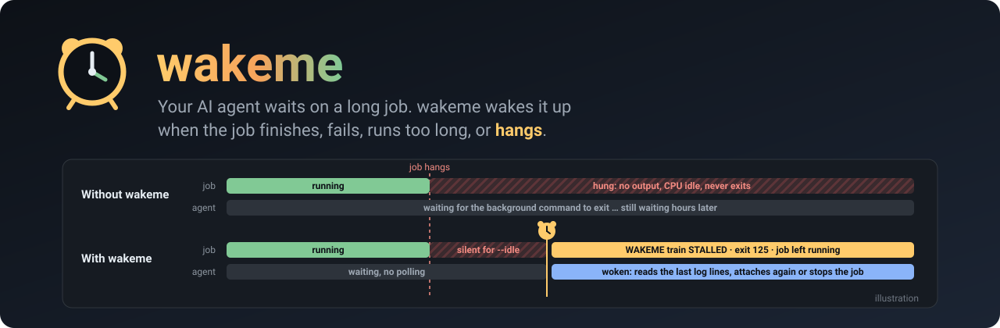
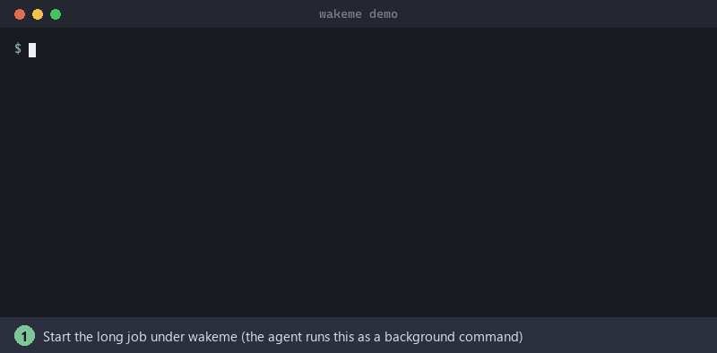
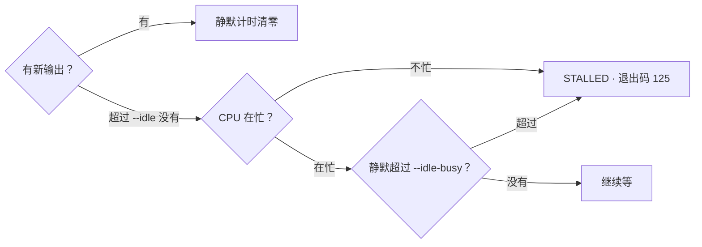
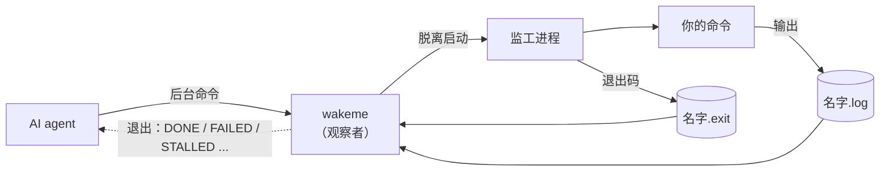

<p align="center">
  
</p>

<p align="center">
  <a href="LICENSE"></a>
  
  
  
  
  <a href="https://github.com/shaojunying/wakeme/stargazers"></a>
</p>

<p align="center">
  <a href="README.md">English</a> · <b>中文</b>
</p>

---

**wakeme 替 AI agent 跑一条长命令，命令一需要关注就立刻退出，让在等它的 agent 醒过来。** Claude Code 这类 agent 把任务作为后台命令启动后，只有这条命令退出时才会被唤醒。任务卡死时命令永远不退出，agent 一等就是几个小时。`wakeme` 把每一种结局（包括卡死）都变成一次退出，并给出明确的最后一行和退出码。

```sh
wakeme --idle 10m -- npm run build
wakeme --idle 15m --expect out/model.bin -- "python train.py"
wakeme --idle 10m -- ssh box1 "cd proj && ./run.sh"
```

## ✨ 为什么做

| | 任务结束时被叫醒 | 任务卡死时被叫醒 | 分得清卡死和慢 | 误报时任务不被杀 | 不用每次现写 |
|---|:---:|:---:|:---:|:---:|:---:|
| 直接用后台命令 | ✅ | ❌ | ❌ | — | ✅ |
| 手写监视循环 | ✅ | ⚠️ 看你记没记得写 | ⚠️ | ⚠️ | ❌ |
| **wakeme** | ✅ | ✅ | ✅ | ✅ | ✅ |

- ⏰ **抓得住卡死**：超过 `--idle` 没输出且 CPU 空闲，就报 `STALLED`。
- 🧠 **不乱报警**：没输出但 CPU 还在转的任务，先当它在干活。
- 🏷️ **说清发生了什么**：固定的最后一行 `WAKEME <名字> <状态>: <原因>`，每种结局一个退出码。
- 🛟 **不凭猜测杀任务**：报卡死时任务继续跑，`--attach` 能重新接上，仍能拿到真实退出码。
- 📏 **帮你调参数**：每次跑完都报告这次的 `longest silence`（最长静默）。
- 🩺 **支持自定义检查**：`--expect` 校验结果文件，`--check` 跑任意检查（比如 loss 变成 NaN）。
- 🪶 **单文件，零依赖**，Node 18+，Windows 和 Linux 都能用。

## 🎬 演示

<p align="center">
  
</p>

<sub>真实运行的录制，按记录的时间回放（为了短一些用了 `--idle 5s`）。上面的 banner 是示意图。</sub>

## 🚀 安装

```sh
git clone https://github.com/shaojunying/wakeme.git
cd wakeme
npm link                                        # 把 `wakeme` 放到 PATH 上
ln -s "$PWD/wakeme.mjs" ~/.local/bin/wakeme     # Linux / WSL 也可以这样
```

## 🤖 给 AI agent 的用法

1. 用 `wakeme --name <名字> --idle <时长> -- <命令>` 作为**后台命令**启动任务。
2. 去做别的事，不要轮询。
3. 它退出时，读最后一行和退出码（见[结局一览](#-结局一览)）。
4. 报 `STALLED` 但日志看着正常？`wakeme --attach <名字> --idle <更长>`。真卡死了？`wakeme --stop <名字>`。

> [!TIP]
> **`--idle` 怎么设**：先跑一次，看最后一行的 `longest silence`，再把 `--idle` 设成它的两三倍。输出很多的任务加 `--quiet`，agent 只会收到最后 20 行，而不是整份日志。

## 🧠 怎么判断卡死



只看"没输出"不可靠，编译器或下载可以很久不出声但完全正常，所以用任务及其子进程的 CPU 时间作为第二个依据。`--idle-busy` 默认是 `--idle` 的 6 倍，`--no-cpu` 表示只按输出判断。电脑休眠的时间不算作静默。

> [!NOTE]
> CPU 信号只能看到本机的进程。任务在 `ssh` 或 `wsl` 后面时，本机那个进程怎样都是空闲的，这种情况只能靠输出判断。

## 🚦 结局一览

最后一行固定是 `WAKEME <名字> <状态>: <原因> ...`。

| | 状态 | 退出码 | 含义 |
|:--:|:--|:--|:--|
| ✅ | `DONE` | 0 | 任务以退出码 0 结束 |
| ❌ | `FAILED` | 命令自己的 | 任务以其他退出码结束（启动不了时是 127） |
| 🧊 | `STALLED` | 125 | 超过 `--idle` 没有输出，任务继续跑 |
| ⏱️ | `TIMEOUT` | 124 | 超过 `--timeout` 还在跑，任务继续跑 |
| 🩺 | `CHECK` | 123 | 你的 `--check` 报警了或者坏了，任务继续跑 |
| 📄 | `EXPECT` | 122 | 退出码是 0，但 `--expect` 指定的文件不存在、为空或比这次运行旧 |
| 🪦 | `ENDED` | 121 | 任务不在了，也没留下退出码（被杀掉了） |
| ✋ | `STOPPED` | 130 | wakeme 自己被中断，任务会被杀掉 |

想在 `STALLED`、`TIMEOUT`、`CHECK` 时连子进程一起停掉任务，就加 `--kill`。如果命令自己恰好以上面某个数字退出，最后一行仍会写 `FAILED: exit code N`，所以退出码有歧义时以最后一行为准。

## 🧩 工作原理



每个任务都跑在自己的一个小监工进程下面，和 `wakeme` 以及启动它的东西都脱离，所以任务比观察者活得久：Windows 上的 Claude Code 会在后台命令结束时清理它名下的进程，普通方式启动的任务会跟着死。观察者可以随时来去：

```sh
wakeme --attach train --idle 30m    # 重新接上继续等，仍能拿到真实退出码
wakeme --stop train                 # 杀掉任务及其子进程
wakeme --list                       # 哪些在跑、哪些结束了、怎么结束的
```

文件在 `~/.wakeme/`（或 `$WAKEME_HOME`）下：`<名字>.log` 是任务的全部输出，`<名字>.json` 是最后的结论，`<名字>.exit` 是任务如何结束。这些文件不会自动删除。

<details>
<summary><b>⚙️ 选项</b></summary>

| 选项 | 作用 |
|:--|:--|
| `--idle D` | 超过 `D` 没输出算卡死（默认 `10m`，`0` 关闭） |
| `--idle-busy D` | CPU 在忙时，超过 `D` 没输出也算卡死（默认是 `--idle` 的 6 倍） |
| `--no-cpu` | 只按输出判断卡死 |
| `--timeout D` | 观察超过 `D` 就放弃 |
| `--expect FILE` | 退出码 0 但没有这个文件（非空、比开始时间新）算失败，可重复 |
| `--check CMD` | 健康检查，每隔 `--check-every` 在 shell 里跑一次 |
| `--check-every D` | `--check` 的间隔（默认 `5m`） |
| `--kill` | 因卡死、超时、检查报警而唤醒时，同时杀掉任务 |
| `--name NAME` | 给任务起名，用于 `--attach` / `--stop` 和文件名 |
| `--quiet` / `--tail N` | 不透传输出，唤醒时只打印最后 `N` 行（默认 20） |
| `--shell EXE` | 运行带引号命令用的 shell，比如 `powershell` 或 `bash` |

时长写成 `90s`、`10m`、`2h`，只写数字表示秒。命令写成**一个带引号的字符串**时在 shell 里运行（可以用管道、`&&`、变量），写成多个参数时直接运行。命令前的 `--` 可以省略，因为 PowerShell 调用 npm 生成的脚本时会把它吞掉；命令本身以 `-` 开头时要保留。

</details>

<details>
<summary><b>🩺 自定义健康检查</b></summary>

有些问题只有你的项目自己看得出来，比如 loss 变成 NaN 而任务还在正常打印。

```sh
wakeme --check "python tools/check_loss.py" --check-every 5m -- "python train.py"
```

检查命令在 shell 里运行，环境变量里有 `WAKEME_LOG`、`WAKEME_PID`、`WAKEME_NAME`，限时 30 秒。退出码 0 表示正常，1 表示叫醒你并带上它打印的内容，其他值算检查本身坏了，同样会叫醒你。

</details>

## 🛡️ 限制

- 电脑休眠期间什么都发现不了。
- `ssh` 任务的连接断了，远端任务通常跟着死，`wakeme` 会报 `FAILED`。它不负责让远端任务存活，那要在远端用 `nohup` 或 `tmux`。
- 报 `STALLED` 且没加 `--kill` 之后，在你重新 `--attach` 之前没人盯着任务，而且任务在 session 结束后还会继续跑。用 `wakeme --list` 可以看到这些任务。

<details>
<summary><b>🧪 开发</b></summary>

- `npm test` 用真实进程跑模拟任务，大约一分半钟。
- `docs/demo/` 里是录制和渲染演示动图的脚本。

</details>

## 📄 许可证

[MIT](LICENSE)
